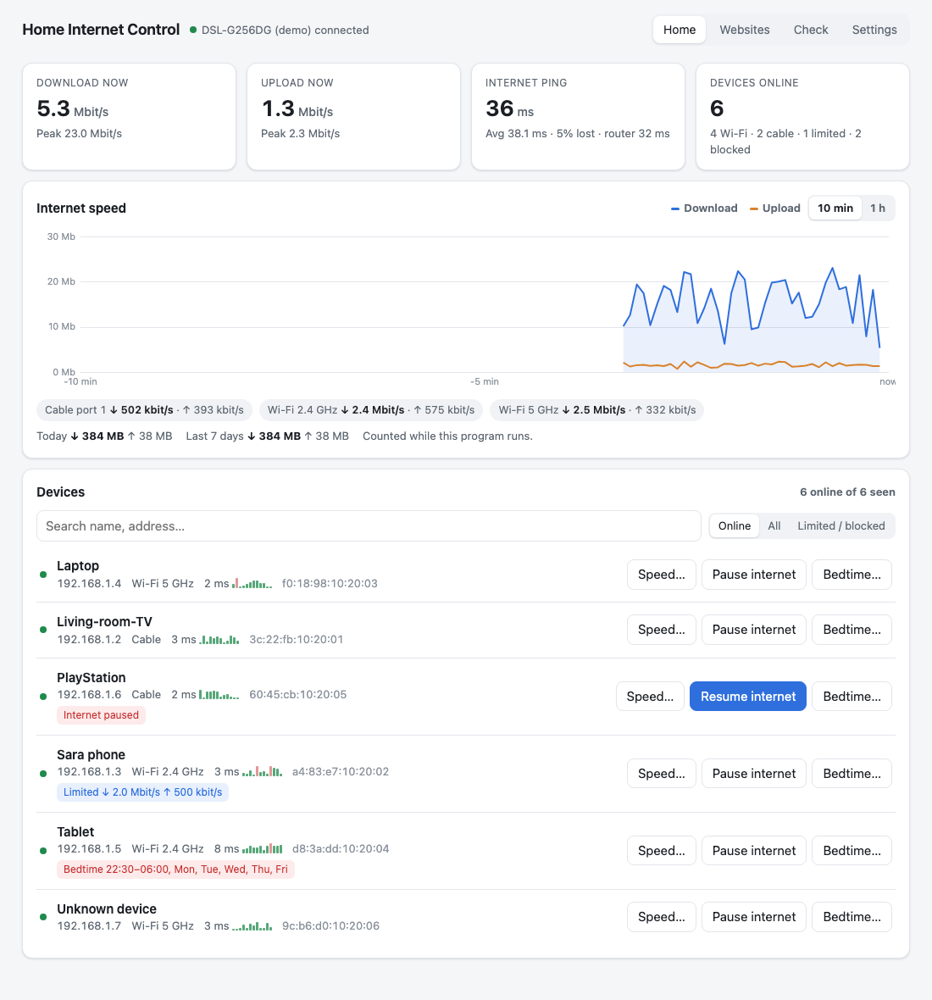

# D-Link DSL Control

A simple page on your computer that shows who is using the home internet and lets you control each device. It's made for D-Link DSL routers with the classic orange-and-black web page (SETUP / ADVANCED / MAINTENANCE / STATUS / HELP), such as the **DSL-G256DG**. These routers are built on the Broadcom platform.



## What it does

| | |
|---|---|
| **Live speed** | Download and upload speed of the whole house, with a 10-minute and 1-hour graph and the speed of each cable port and Wi-Fi band |
| **Devices** | Every device with its name, address, Wi-Fi band or cable, online or offline, and ping time |
| **Speed limit** | Set a download and upload limit for one device (for example 2 Mbit/s for a phone) |
| **Pause internet** | Cut one device off the internet until you press Resume. It stays connected to the Wi-Fi |
| **Bedtime** | No internet for a device between, for example, 23:00 and 07:00, on the days you choose |
| **Block websites** | Block a website for the whole house |
| **Ping** | Ping to the internet, to the router and to every device, with a small history |
| **Phone** | Use the same page from phones on the home Wi-Fi, protected by a PIN, with a QR code to sign in and an app icon |
| **Check** | A one-minute test that proves the limits really work on *your* router, and a report to send to whoever helps you |

Everything runs on your own computer. Nothing is sent anywhere, except during the speed test on the Check page (it downloads test data from speed.cloudflare.com).

## Start it

1. Install **Python 3** from <https://www.python.org/downloads/>. On Windows, tick **"Add python.exe to PATH"** during setup.
2. Download this project (green **Code** button → **Download ZIP**) and unzip it.
3. Double-click **`start-windows.bat`** (Windows) or **`start-mac.command`** (Mac).
4. Your browser opens the page. Go to **Settings**, enter the router password (the one you use for the router's own page, usually at `192.168.1.1`), and press **Save and connect**.
5. Go to **Check** and press **Run the speed-limit test** once.

Keep the black window open while you use the page; closing it stops the program. Limits, pauses and bedtimes stay on the router even when the program is closed.

To try it without a router: `python run.py --demo`. This starts a fake router.

## Use it from your phone

The program runs on the computer; phones on the **home Wi-Fi** can open the same page.

1. On the computer: **Settings → Use from your phone → Turn on** (or start with `start-with-phone` instead of `start`). On Windows, if asked, press **Allow** for Python on private networks.
2. A QR code and a 6-digit **PIN** appear in Settings (and in the black window).
3. On the phone: point the camera at the QR code and open the link. The QR code includes the PIN, so the phone is signed in straight away. Or type the address and enter the PIN.
4. Make it an app icon: **iPhone** Safari → Share → *Add to Home Screen*. **Android** Chrome → ⋮ → *Add to Home screen*.

Good to know:
- Phones stay signed in. **New PIN** in Settings signs every phone out (for example if someone saw the PIN).
- After 5 wrong PINs a phone must wait 5 minutes.
- The computer must be on with the program running. Away from home the page cannot be reached; that keeps it private.
- Turning phone access on or off, and seeing the PIN, is only possible on the computer itself.

## How it works (and its limits)

The program does what you would do by hand in the router's page, then reads the page again to confirm the router saved it:

- **Speed limit** = two rules under *Advanced → Network Tools → QoS Classification*. An upload rule matches the device's hardware address and goes to the internet queue with a rate limit. A download rule matches traffic from the internet to the device's address and goes to that device's Wi-Fi queue with a rate limit. If the router's QoS switch is off, the program switches it on.
- **Pause / Bedtime** = *Parental Control → Block MAC Address*, with "Always" or a schedule the program creates.
- **Websites** = *Parental Control → Block Website*.

Rules the program makes are named `ru…`, `rd…`, `bk…` and `rc…`. Rules you made yourself in the router are shown but never changed.

Things to know:

- **Download limits.** These routers are designed to limit *upload*. Whether a download limit is obeyed depends on the firmware. The test on the Check page finds out. If download is not obeyed, the program holds download down with a low upload cap instead (about 1/12 of the wanted download). This works, but it also slows the device's upload.
- **Cable devices.** The router has no queue per cable port, so download limits for cable devices are less certain than for Wi-Fi devices. Run the Check test from a cable computer to see.
- **Changing addresses.** If a device gets a new address, the program moves its download limit automatically while the program is running. Phones that use a "private" or random Wi-Fi address show up as a new device whenever that address changes. Turn that off for the home Wi-Fi in the phone's Wi-Fi settings.
- **Bedtime needs the router clock.** If the router's time is not set, bedtimes don't start on time. The page warns you.
- **Per-device data use.** The router doesn't count data per device, so the page shows speed per cable port and Wi-Fi band, not per phone.
- **Rule limits.** The router holds about 16–32 speed rules, so about 8–16 limited devices.
- **One login at a time.** If someone opens the router's own page while this program runs, one of them may be logged out. The program logs in again by itself.

## If something doesn't work

Open **Check → Create report → Copy** and send it to whoever helps you. It lists which router pages and form fields were found. Device addresses are shortened and the password is not included. Most firmware differences can be fixed in `config.json` without changing code:

```json
{
  "pages":  { "qosform": "qosclsadd.html" },
  "params": { "qos.rate": "rateLimit" }
}
```

`pages` names the router page for a feature: `dhcp`, `stations`, `wanstats`, `lanstats`, `qos`, `qosform`, `qosmgmt`, `blockmac`, `sched`, `urlflt`. `params` renames a form field; see `routerctl/router.py` for the keys.

## Files

```
run.py               starts everything (start-*.bat / start-*.command double-click it)
routerctl/router.py  talks to the router (login, pages, rules)
routerctl/control.py devices, limits, blocks, background checks
routerctl/selftest.py the speed-limit test
routerctl/report.py  the report for helpers
routerctl/qr.py      QR codes for the phone link (no library needed)
routerctl/web/       the page
tools/mock_router.py fake router for the demo and tests
tools/make_icons.py  draws the home-screen icons
tests/               python -m unittest discover -s tests
config.json          your settings (created on first save, holds the router password — keep it private)
data/                remembered devices, limits and the action log
```

Requires Python 3.8 or newer; nothing else to install.

## License

MIT. Not made by or connected with D-Link. Use at your own risk: the program changes settings on your router, and you can always see and undo them in the router's own page.
